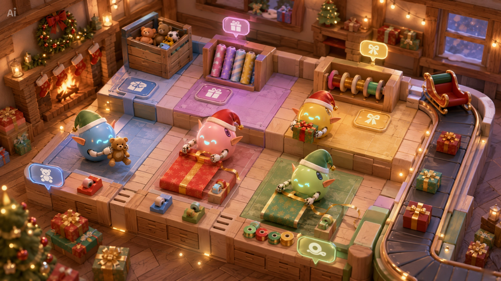

# 🎁 Master Gift Wrapper

**Santa's Workshop – Christmas Co-op Challenge.** A team of 1 to 4 little elves has 3 minutes to pack, wrap and dispatch as many presents as possible. Everyone plays on their own phone or computer and shares one 3D workshop.

- **Join by room code, invite link or QR code**
- **One shared workshop**: you see every elf move, and can pass things to each other on any worktop
- **Orders that grow**: toy in a box → wrapping paper → ribbon or bow → both
- **Three difficulties**: Easy, Normal and Chaos, chosen by the host in the lobby
- **Touch or keyboard**: on-screen joystick and one action button, or arrows/WASD and Space
- **Host handover**: if the host drops out, the next player takes over and the shift carries on
- **No build step**: plain HTML, CSS and JavaScript modules, hosted free on GitHub Pages with Firebase for live sync



## How to play

1. **Check the orders** at the top of the screen. Each ticket shows the toy and what the finished present looks like.
2. **Pack**: grab a box 📦, then the toy (or the other way round).
3. **Wrap**: add the right colour of paper, put the box on a **green wrapping table**, and press the action button until it is wrapped.
4. **Decorate**: add a ribbon and/or a bow if the ticket shows one. They only stick to a wrapped present.
5. **Dispatch**: take it to the conveyor belt 🛷.

**Scoring**

| What happened | Points |
| --- | --- |
| Toy in a box | +10 |
| Wrapped in the right paper | +15 |
| Wrapped, with the ribbon or bow the order asks for | +20 |
| Wrapped, with both ribbon and bow | +25 |
| Sent while more than half of the order's time is left | +3 speed tip |
| Right toy and paper but wrong, missing or extra decorations | points for the toy and wrapping only (10 or 15) |
| Wrong or unfinished present, on Normal and Chaos | −5 (the present is lost) |
| Order runs out of time, on Normal and Chaos | −5 |
| Wrong or unfinished present, on Easy | 0 (it is handed back) |
| Order runs out of time, on Easy | 0 |

When the timer reaches zero nothing more can be dispatched. The team score, and each elf's share of it, are shown at the end. The high score is remembered per difficulty.

**Controls**

| | Move | Action |
| --- | --- | --- |
| Touch (hold the phone sideways) | Joystick (bottom left) | Round button (bottom right). Its label tells you what a press will do. |
| Keyboard | Arrow keys or WASD | Space (or E / Enter) |

## Try it right now (no setup)

Until you add a Firebase config, the game runs in **local demo mode**. It syncs between tabs on one device.

```bash
cd master-gift-wrapper
python3 -m http.server 8000
# open http://localhost:8000 in one tab to play solo, or more tabs to add elves
```

Add `?secs=30` to the address for a short 30-second test shift.

## Set up Firebase (about 5 minutes, free)

You can either make a new Firebase project, or **reuse the one from Bauble Shake**. This game keeps its rooms under `giftRooms`, so the two games don't get in each other's way.

**New project**

1. Go to <https://console.firebase.google.com> → **Add project**. Analytics isn't needed.
2. **Build → Authentication → Get started → Sign-in method → Anonymous → Enable.**
3. **Build → Realtime Database → Create database**. Pick a region, then start in **locked mode**.
4. Open the database's **Rules** tab, paste in the contents of [`database.rules.json`](database.rules.json), and click **Publish**.
5. **Project settings (⚙) → Your apps → Web (`</>`)**. Register an app, choose **"Use a `<script>` tag"**, then copy only the config values into [`js/firebase-config.js`](js/firebase-config.js). Keep the word `export`. Make sure `databaseURL` is included. If it's missing, copy it from the Realtime Database page.
6. **Authentication → Settings → Authorized domains**: add `YOUR-USERNAME.github.io`.

**Reusing the Bauble Shake project**

1. Copy the config values from Bauble Shake's `js/firebase-config.js` into this game's `js/firebase-config.js`.
2. In the Firebase console open **Realtime Database → Rules**. Keep the existing `"rooms": { ... }` block, add a comma after it, and paste the whole `"giftRooms": { ... }` block from [`database.rules.json`](database.rules.json) next to it. Click **Publish**.

The web config is meant to be public, so committing it is fine. Access is controlled by the database rules.

## Deploy to GitHub Pages

```bash
cd master-gift-wrapper
git init && git add . && git commit -m "Master Gift Wrapper"
git branch -M main
git remote add origin https://github.com/YOUR-USERNAME/master-gift-wrapper.git
git push -u origin main
```

Then on GitHub: **Settings → Pages → Branch: main / root → Save**. The game appears at `https://YOUR-USERNAME.github.io/master-gift-wrapper/` a minute or two later.

## Troubleshooting

- **A yellow "Local demo mode" bar at the top** means the Firebase config isn't in use yet: it still has the `YOUR_...` placeholders, or the change hasn't been pushed.
- **Invite links containing `&local`** were made in demo mode. Once the config is live, share a fresh link.
- **"Couldn't connect to the game server"**: check that Anonymous sign-in is enabled and that your `github.io` address is in the authorized domains.
- **"Couldn't create a room"**: the database rules haven't been published, or the `giftRooms` block is missing.
- **Phones play in landscape.** If a phone is held upright, the game is drawn sideways so that turning the phone puts it the right way up. This also works when the phone's rotation lock is on.
- **Slow or jerky on an old phone**: the game lowers its picture quality by itself after a few seconds. Adding `&lq` to the address starts it in the lightest mode.

## Tweaking the game

Everything about the rules lives in [`js/rules.js`](js/rules.js):

- `MAP` is the workshop floor plan, one letter per square.
- `DIFFICULTY` sets wrap taps, order timers, how fast orders arrive and how many can wait.
- `POINTS_BASE`, `POINTS_STEP` and `SPEED_TIP` set the scoring, and `penalty` in `DIFFICULTY` sets the points lost for mistakes.
- `GAME_MS` is the length of a shift.

| File | What it does |
| --- | --- |
| `index.html`, `css/style.css` | Pages and styling |
| `js/main.js` | Rooms, lobby, results |
| `js/game.js` | One round: your elf, the HUD, and the host's order queue |
| `js/rules.js` | Game rules (no drawing, no networking) |
| `js/scene.js` | The 3D workshop |
| `js/input.js` | Keyboard, joystick and action button |
| `js/backend-firebase.js`, `js/backend-local.js` | Live sync, and the demo-mode stand-in |
| `js/vendor/three.module.min.js` | Three.js r160 (MIT licence), bundled so there is nothing to install |

## How the sync works

- The **host's device runs the workshop**: the order queue, what is on each worktop, what each elf holds, and the score. It writes that to `giftRooms/CODE/game`.
- **Every player moves their own elf** and shares its position about 10 times a second. Pressing the action button sends a small "I pressed at this square" message that the host applies.
- All timing uses the server clock, so the countdown and the 3-minute timer match on every device.
